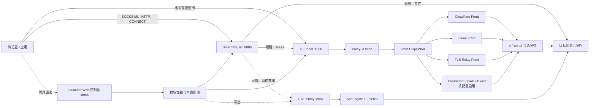
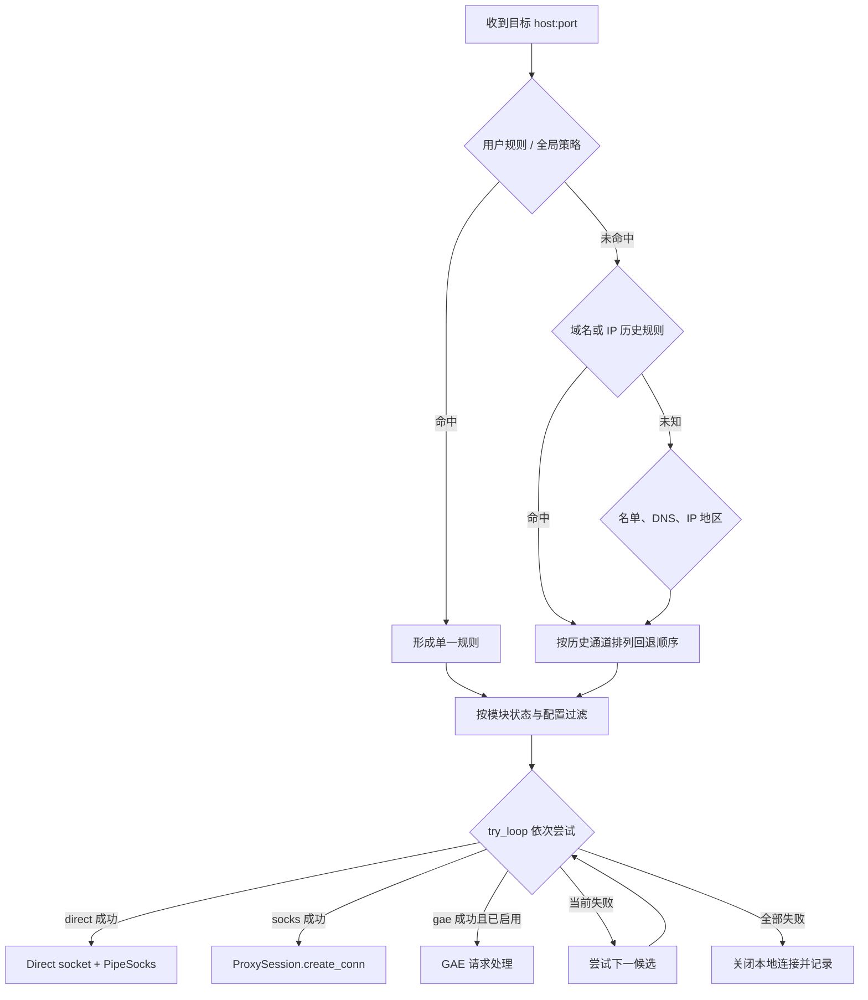
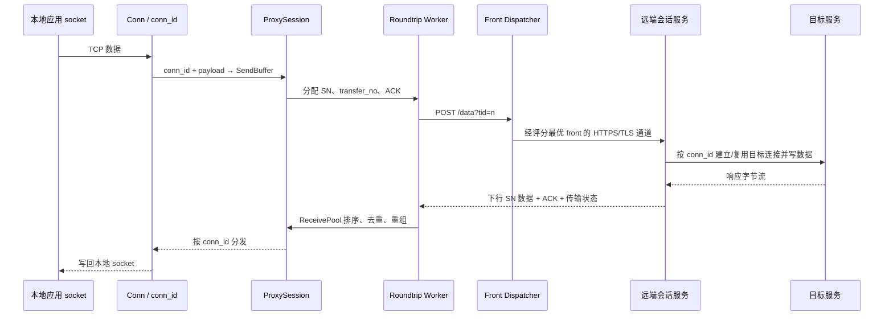

# XX-Net 5.16.7.1：项目原理、功能与系统架构

> 依据当前仓库真实源码整理，不以 README 宣传代替实现结论。  
> 代码快照：`Coding/XX-Net-5.16.7.1`；整理日期：2026-11-03。  
> 配套可导出架构图：[xx-net-system-architecture.html](xx-net-system-architecture.html)。

## 1. 一句话理解 XX-Net

XX-Net 是一个运行在用户电脑上的**应用层代理与智能分流系统**：它把浏览器或其他应用的 SOCKS/HTTP 请求接入本地，按域名、IP、规则和历史状态选择直连、X-Tunnel 或可选 GAE 通道，再通过不同网络前端把流量送往目标站；Launcher 负责启动、配置、日志和 Web 管理。

它不是微服务集群，也不能简单等同于操作系统级 VPN。核心模块运行在同一个 Python 进程中，以线程协同工作；主要工作在 HTTP、SOCKS、TLS 和应用层会话协议上。

## 2. 当前本机实际运行形态

根据已核验的生产配置：

| 项目 | 当前状态 | 默认地址/作用 |
|---|---|---|
| Launcher | 主进程与控制面 | `127.0.0.1:8085`，Web UI/API、配置、日志、模块生命周期 |
| Smart Router | **启用** | `127.0.0.1:8086`，统一代理入口与智能分流 |
| X-Tunnel | **启用** | `127.0.0.1:1080`，可独立使用，也可被 Smart Router 调用 |
| GAE Proxy | 可选，**当前禁用** | 默认 `127.0.0.1:8087`，AppEngine 代理通道 |
| 系统自动代理 | 当前禁用 | 是否自动改系统代理由 Launcher 配置和系统代理模块决定 |

因此，本机主要代理链路是：

```text
应用 → Smart Router:8086 → 按规则选择 Direct 或 X-Tunnel → 目标站
```

GAE 的代码和完整能力仍在仓库中，但当前没有加载，不能把“代码存在”写成“生产已启用”。

## 3. 总体系统架构



### 控制流与代理数据流必须分开理解

- **控制流**：用户或 Web UI 访问 8085，修改配置、查询状态、导出日志、启动/停止模块。Launcher 再把 `/module/<name>/control/...` 请求委托给对应模块。
- **代理数据流**：应用访问 8086 或 1080，Smart Router/X-Tunnel 建立目标连接并搬运数据。
- 8085 不是业务代理入口；模块之间主要通过 Python 对象和函数调用协作，而不是内部 HTTP 微服务调用。Smart Router 也可以直接调用 X-Tunnel 的 `ProxySession.create_conn()`。

## 4. 进程、启动与模块生命周期

### 4.1 单进程、多模块、多线程

[module_init.py](../Coding/XX-Net-5.16.7.1/code/default/launcher/module_init.py) 通过 `__import__` 动态加载 `gae_proxy`、`smart_router`、`x_tunnel`，然后为各模块的 `local.start()` 创建线程并等待 ready。模块不是独立部署的服务，失败和退出需要由 Launcher 统一协调。

### 4.2 启动主顺序

[start.py](../Coding/XX-Net-5.16.7.1/code/default/launcher/start.py) 的主要顺序为：

1. 初始化运行环境、路径和日志。
2. 加载配置并执行更新相关逻辑。
3. 按启用配置启动各代理模块。
4. 启动 8085 Web 控制面。
5. 启动系统托盘/桌面集成。
6. 退出时停止模块和 Web 控制服务。

### 4.3 Smart Router 的内部启动顺序

[smart_router/local/__init__.py](../Coding/XX-Net-5.16.7.1/code/default/smart_router/local/__init__.py) 先初始化规则、缓存、直连管理、双向 socket 转发和 DNS/UDP 资源，最后启动 8086 代理监听。这个顺序很重要：如果代理入口先于依赖对象暴露，早期请求可能访问尚未初始化的 DNS 或 UDP 对象。

## 5. Launcher：控制面与平台能力

Launcher 不是流量转发核心，主要负责：

- 动态加载、启动、停止模块；
- 提供 Web UI 与 JSON/API；
- 读取和保存 Launcher/模块配置；
- PAC 与系统代理模式管理；
- 版本更新、启动脚本和平台依赖；
- 托盘、桌面通知和打开管理页面；
- 各模块日志查看、诊断信息和重启/退出。

[web_control.py](../Coding/XX-Net-5.16.7.1/code/default/launcher/web_control.py) 使用项目自带的 `simple_http_server`，不是外部 Web 框架。`/config`、`/log`、`/debug`、`/restart`、`/quit` 等属于管理接口；`/module/<module>/control/...` 则路由到模块自己的控制处理器。

配置系统 [xconfig.py](../Coding/XX-Net-5.16.7.1/code/default/lib/noarch/xconfig.py) 采用“代码默认值 + JSON 文件覆盖”的方式，通常只保存非默认项。账号、密码等敏感配置不属于本文展示范围。

## 6. Smart Router：统一入口与智能分流

### 6.1 一个端口识别多种代理协议

[proxy_handler.py](../Coding/XX-Net-5.16.7.1/code/default/smart_router/local/proxy_handler.py) 读取首字节判断协议：

| 首字节/形式 | 处理路径 |
|---|---|
| `0x04` | SOCKS4 / SOCKS4a |
| `0x05` | SOCKS5，支持 TCP CONNECT 和 UDP ASSOCIATE |
| `CONNECT` | HTTP CONNECT 隧道 |
| `GET/POST/...` | 普通 HTTP 代理请求 |
| 本地 `/dns-query` | DoH JSON 查询 |
| 其他本地 HTTP 路径 | PAC/本地服务处理 |

Linux 透明代理场景还可通过 `SO_ORIGINAL_DST` 取原始目标地址。它是“应用代理入口 + 可选 DNS/UDP 服务”，不是自动接管所有操作系统流量的内核 VPN。

### 6.2 PAC 的角色

[pac_server.py](../Coding/XX-Net-5.16.7.1/code/default/smart_router/local/pac_server.py) 支持 `black_GAE`、`black_X-Tunnel`、`smart-router`、`all_X-Tunnel`、`all_Direct` 等策略。

- `smart-router`：把应用引导到 8086，由 Smart Router 做统一判断。
- 黑名单模式：PAC 可先把不同目标指向 GAE 或 X-Tunnel。
- 全直连/全 X-Tunnel：提供强制策略。
- PAC 只决定“应用把请求交给谁”；真正的目标连接、失败回退和通道能力仍由后端模块完成。

### 6.3 分流决策顺序

[smart_route.py](../Coding/XX-Net-5.16.7.1/code/default/smart_router/local/smart_route.py) 的核心不是固定的一张“国内直连、国外代理”表，而是带优先级和回退的候选规则列表：

1. **用户规则**优先；私有 IP 默认直连。
2. 全 Direct、全 X-Tunnel 等全局策略可覆盖普通判断。
3. 可阻断广告域名。
4. 查询域名/IP 历史缓存，复用此前可行通道。
5. 结合地区 IP 数据、block/white list 等名单生成候选列表。
6. 根据 `auto_direct`、`auto_gae`、IPv6、fake CA 和模块可用性删减候选。
7. `try_loop()` 按顺序尝试 `direct`、`gae`、`socks` 等；某个通道不可用或建连失败时尝试后续通道。



### 6.4 Direct 与双向转发

[connect_manager.py](../Coding/XX-Net-5.16.7.1/code/default/smart_router/local/connect_manager.py) 负责 Direct 建连：

- DNS 得到候选 IP 后按历史连接质量排序；
- 可用多个建连线程竞争，减少单个慢地址拖累；
- 缓存可用连接信息；
- 支持上层 HTTP/SOCKS 代理配置。

连接建立后，`PipeSocks` 用 selector 在本地 socket 与远端 socket 之间双向搬运字节。Direct 不经过 X-Tunnel 会话协议。

### 6.5 DNS、DoH、DoT 与 UDP

Smart Router 还包含：

- 本地 DNS UDP/TCP 服务，默认另有备份端口；
- HTTP `/dns-query` 的 JSON DoH 接口；
- 上游 DNS、DoH/DoT 查询与缓存；
- SOCKS5 UDP ASSOCIATE 中继；
- DNS 地址过滤、不可达上游退避与必要的 fail-open 行为。

DNS 为 Direct 提供地址，也参与未知域名的地区/分流判断；X-Tunnel 的会话流量则通过已配置的 front 连接远端，不应把所有 DNS 查询都理解为经过代理隧道。

## 7. X-Tunnel：把本地 TCP 连接映射为可靠会话

### 7.1 本地入口与远端通道

[client.py](../Coding/XX-Net-5.16.7.1/code/default/x_tunnel/local/client.py) 初始化 front，创建全局 `ProxySession`，再监听本地 SOCKS/HTTP 入口。默认 1080；端口占用时可尝试后续端口。

[proxy_handler.py](../Coding/XX-Net-5.16.7.1/code/default/x_tunnel/local/proxy_handler.py) 支持 SOCKS4、SOCKS5、HTTP 和 CONNECT，但这里的 SOCKS5 只实现 TCP CONNECT，**不支持 UDP ASSOCIATE**。需要 UDP 中继时应使用 Smart Router 的对应能力，不能混淆两个入口。

### 7.2 会话协议的三个编号

[proxy_session.py](../Coding/XX-Net-5.16.7.1/code/default/x_tunnel/local/proxy_session.py) 用不同编号解决不同层次的问题：

| 编号 | 作用 |
|---|---|
| `session_id` | 标识一次登录后的全局代理会话 |
| `conn_id` | 标识一条本地应用到目标 host:port 的逻辑 TCP 连接 |
| `transfer_no` | 标识一次 HTTPS `/data` 往返传输，用于状态跟踪和超时重试 |
| `SN` | 给发送/接收数据块排序，支持 ACK、重传和乱序处理 |

创建连接时，本地 socket 被登记为 `Conn`，并向发送缓冲写入“创建连接”命令及目标地址。多个连接共享同一个会话和多个 roundtrip worker。

### 7.3 登录与往返请求

1. `login_session()` 通过当前 `g.http_client` 向会话服务器 POST `/data`，携带协议版本、会话 ID、窗口/超时参数和登录信息。
2. 登录成功后固定会话服务主机，重置序号、ACK 和接收状态，启动多个 `normal_round_trip_worker`。
3. worker 从 `SendBuffer` 取数据，附带 ACK 与下载等待参数，生成 `transfer_no`，POST 到 `/data?tid=<n>`。
4. 响应同时可包含下行数据、发送 ACK、服务端传输进度和未确认序号信息。
5. 发送侧在超时后重传未确认 SN 或重试 transfer；接收侧按 SN 重组，再把 `conn_id` 对应的数据交回本地连接。



### 7.4 可靠性不是“每条消息一个独立代理请求”

[base_container.py](../Coding/XX-Net-5.16.7.1/code/default/x_tunnel/local/base_container.py) 中的关键结构：

- `SendBuffer`：聚合多个连接的数据，按 `max_payload` 切块并分配 SN；
- `wait_ack_send_list`：保留未确认数据，供超时重传；
- `BlockReceivePool`：处理乱序和重复 SN，连续交付；
- `AckPool`：累计接收确认；
- `ConnectionPipe`/`Conn`：维护逻辑连接命令、窗口和本地 socket 读写。

因此，X-Tunnel 是在 HTTPS 往返之上实现了一个带连接复用、排序、ACK、超时和窗口控制的应用层会话层。

### 7.5 Front Dispatcher 与多前端

[front_dispatcher.py](../Coding/XX-Net-5.16.7.1/code/default/x_tunnel/local/front_dispatcher.py) 区分：

- **light fronts**：账号、配置等较轻的控制请求；
- **session fronts**：实际代理会话的 `/data` 请求。

`get_front()` 根据各 dispatcher 的 `get_score()` 选择前端。当前代码包含 Cloudflare、CloudFront、Seley、TLS Relay、GAE、Direct 等实现，但默认启用情况不同；其中 Cloudflare、Seley、TLS Relay 默认开启，其他需看配置。

这些 front 是“到达 X-Tunnel 服务的传输适配层”，不是各自独立完成最终目标代理。它们共享 IP/TLS/连接池/HTTP worker 等基础设施，最终仍进入会话服务，再由会话服务访问目标。

### 7.6 加密边界要准确理解

- 本地浏览器到 X-Tunnel 的 CONNECT 是普通本地隧道入口，不做 GAE 式站点证书 MITM。
- front 到服务端通常有 HTTPS/TLS 传输保护。
- X-Tunnel 自己还有可选的 `encrypt_data()/decrypt_data()` 应用层加密，但 `encrypt_data` 默认值为 0，不能声称所有负载始终额外加密。
- 端到端 HTTPS 站点的内容保护仍取决于应用与目标站之间的 TLS。

## 8. GAE Proxy：可选的 AppEngine 请求代理

GAE 是另一套数据面，不是 X-Tunnel 的简单别名。

### 8.1 本地处理

- 默认监听 `127.0.0.1:8087`；
- 接收普通 HTTP 代理和 CONNECT；
- CONNECT 场景可由本地 GoAgent CA 动态签发目标站点证书，进行本地 TLS MITM，再读取 HTTP 请求；
- 本地/局域网地址可直接转发，部分目标可走 Direct，其他进入 GAE handler。

核心文件：

- [proxy.py](../Coding/XX-Net-5.16.7.1/code/default/gae_proxy/local/proxy.py)
- [proxy_handler.py](../Coding/XX-Net-5.16.7.1/code/default/gae_proxy/local/proxy_handler.py)
- [cert_util.py](../Coding/XX-Net-5.16.7.1/code/default/gae_proxy/local/cert_util.py)

### 8.2 GoAgent 打包与远端执行

[gae_handler.py](../Coding/XX-Net-5.16.7.1/code/default/gae_proxy/local/gae_handler.py) 将 HTTP 请求压缩、打包，POST 到 AppEngine 应用的 `/_gh/`；[server/gae/main.py](../Coding/XX-Net-5.16.7.1/code/default/gae_proxy/server/gae/main.py) 在远端解包并通过 urlfetch/requests 请求目标站，再返回响应。大响应可按 Range 分片下载。

它依赖用户 AppID 或打包的公共 AppID。AppID 管理和配额错误会影响可用性。此路径与 X-Tunnel 的 `conn_id`/SN/ACK 会话协议不同。

### 8.3 当前实现与旧宣传的边界

- 当前 GAE 在本机未启用。
- 当前 `sni_manager.py` 的随机 SNI 逻辑直接返回 `None`，不能按旧资料声称正在使用随机 SNI。
- PKP 相关逻辑只存在于旧 Python 2 分支，不能当作当前 Python 3 的通用能力。
- 不应把历史版本中的 TLS 分片等描述无条件套用到当前快照。

## 9. 共享 Front 基础设施

`front_base` 为 GAE 与 X-Tunnel 的多个 front 提供可复用网络底座：

```text
IP Source / 扫描
      ↓
IP Manager：质量、延迟、失败反馈
      ↓
Connect Creator：TCP/TLS/SNI/证书
      ↓
Connect Manager：建连与连接池
      ↓
HTTP Dispatcher：按评分选 worker
      ↓
HTTP/1.1 或 HTTP/2 Worker：发送请求、重试、回收
```

它的价值是把“如何找到可用前端连接”与“上层代理协议”解耦：X-Tunnel 会话和 GAE 请求可以复用连接质量评分、TLS 建连、H1/H2 worker 和健康反馈。

不同 front 的域名、CA、IP 来源、HTTP/2 细节和默认开关并不相同，不能把它们视为完全等价的线路。

## 10. 三条典型请求链路

### 10.1 Smart Router 判定 Direct

```text
应用 → 8086 协议识别 → 用户规则/名单/缓存 → DNS 解析
     → ConnectManager 选择可用 IP → TCP/TLS 由应用端到端建立
     → PipeSocks 双向复制 → 目标站
```

### 10.2 Smart Router 判定 X-Tunnel

```text
应用 → 8086 → try_loop 选择 socks
     → 直接调用 ProxySession.create_conn（不是必须先走 1080）
     → SendBuffer / SN / transfer_no
     → roundtrip worker → front_dispatcher
     → Cloudflare/Seley/TLS Relay 等 → 会话服务 → 目标站
     → 下行 SN 重组 → conn_id → 本地 socket
```

1080 是独立使用 X-Tunnel 的本地入口；Smart Router 的内部调用并不等价于“8086 再通过 SOCKS 连接 1080”。

### 10.3 可选 GAE

```text
应用 → 8087 → CONNECT 本地 CA MITM（HTTPS 时）
     → 解析 HTTP → 压缩/GoAgent 打包
     → Google 前端 IP + H1/H2 worker
     → AppEngine /_gh/ → urlfetch → 目标站
```

当前生产配置禁用该模块，所以这条链是架构能力说明，不是当前运行事实。

## 11. 本地版本的关键改造

[LOCAL-VERSION.md](../Coding/XX-Net-5.16.7.1/LOCAL-VERSION.md) 记录此快照在官方版本上的本地补丁。与架构关系最大的包括：

- **macOS ARM64 原生 BoringSSL**：避免依赖非本机架构二进制。
- **启动竞态与失败清理**：先准备 DNS/UDP 等依赖，再开放代理入口；启动失败时回收已创建资源。
- **DNS 健壮性**：过滤不可路由 nameserver，限制 IPv6 全球单播范围，上游不可达退避和 fail-open。
- **统一日志**：每个 logger 对应 `<name>.log`，单代 `.1` 滚动，持久正文与内存视图并存。
- **日志节流与生命周期尾账**：重复异常聚合，reset/stop 时 flush suppressed 计数，避免静默丢失。
- **诊断视图**：startup/warning 视图、错误上下文和诊断包；敏感配置脱敏失败时采用 fail-closed。

这些属于本地可靠性增强，不改变三条核心代理数据面的基本职责。

## 12. 安全与信任边界

1. **本机边界**：默认监听 `127.0.0.1` 降低局域网暴露风险；若改成允许远程访问，控制面和代理面的暴露风险会显著增加。
2. **控制面边界**：8085 能改配置、看日志和控制模块，应与业务代理入口分开保护。
3. **GAE MITM 边界**：安装并信任本地 CA 后，GAE 可解密经过它的 HTTPS 请求再转发；这与 X-Tunnel 的普通 CONNECT 隧道不同。
4. **远端服务边界**：Direct 由目标站直接看到客户端；X-Tunnel 会话服务承担目标连接；GAE AppEngine 承担 urlfetch。不同路径的运营方和可见内容不同。
5. **传输加密不等于端到端匿名**：front 的 TLS 保护的是相应传输段，不自动消除目标站、远端服务或本地日志的元数据可见性。
6. **诊断数据边界**：日志和配置可能含域名、路径、账号等信息，分享诊断包前仍需检查；代码中的脱敏不是人工审查的替代品。

## 13. 功能边界与常见误解

| 常见说法 | 源码中的准确含义 |
|---|---|
| “XX-Net 就是 VPN” | 主要是本地 SOCKS/HTTP 应用代理；透明重定向是特定支持，不等于全局 VPN。 |
| “8085 是代理端口” | 8085 是 Launcher 管理控制面；主要代理入口是 8086/1080，GAE 可选 8087。 |
| “Smart Router 必须经过 1080 调 X-Tunnel” | 可直接调用 `ProxySession.create_conn()`；1080 是独立入口。 |
| “X-Tunnel 支持 SOCKS5 UDP” | 当前本地 handler 只接受 TCP CONNECT；UDP ASSOCIATE 在 Smart Router。 |
| “所有 front 都默认开启” | 各 front 有独立配置；CloudFront、Direct、GAE front 默认并非全部开启。 |
| “X-Tunnel 始终额外应用层加密” | `encrypt_data` 默认关闭；front TLS 与可选负载加密要分开描述。 |
| “GAE 当前可用且启用” | 代码完整保留，但当前生产 `gae_proxy_enable=0`。 |
| “日志节流会丢异常” | 首报与计数保留，reset/stop 结算 suppressed；具体生产故障仍需证据，不由架构推断疗效。 |

## 14. 源码阅读地图

| 主题 | 建议入口 |
|---|---|
| 总启动与模块生命周期 | `code/default/launcher/start.py`、`module_init.py` |
| Web 控制面 | `code/default/launcher/web_control.py` |
| Smart Router 启动 | `code/default/smart_router/local/__init__.py` |
| 多协议入口 | `smart_router/local/proxy_handler.py` |
| 分流规则与回退 | `smart_router/local/smart_route.py` |
| Direct 建连 | `smart_router/local/connect_manager.py` |
| DNS | `smart_router/local/dns_query.py`、`dns_server.py` |
| PAC | `smart_router/local/pac_server.py` |
| X-Tunnel 启动 | `x_tunnel/local/client.py` |
| X-Tunnel 本地协议入口 | `x_tunnel/local/proxy_handler.py` |
| 会话、SN、ACK、重试 | `x_tunnel/local/proxy_session.py` |
| 缓冲与连接状态 | `x_tunnel/local/base_container.py` |
| Front 选择 | `x_tunnel/local/front_dispatcher.py` |
| GAE 本地代理 | `gae_proxy/local/proxy.py`、`proxy_handler.py` |
| GAE 请求协议 | `gae_proxy/local/gae_handler.py`、`server/gae/main.py` |
| 共享网络底座 | `lib/noarch/front_base/` |
| 统一日志 | `lib/noarch/xlog.py` |

## 15. 最简心智模型

把整个项目记成四层即可：

1. **接入层**：8086/1080/可选 8087 识别 SOCKS、HTTP、CONNECT。
2. **决策层**：Smart Router 根据规则、名单、缓存和模块状态选择 Direct/X-Tunnel/GAE。
3. **传输层**：Direct 直接搬字节；X-Tunnel 维护可靠会话和多 front；GAE 打包 HTTP 请求到 AppEngine。
4. **控制与基础层**：Launcher 管生命周期和配置，`front_base` 管前端连接质量，xlog 管日志与诊断。

这四层共同构成 XX-Net 的真实系统架构。
